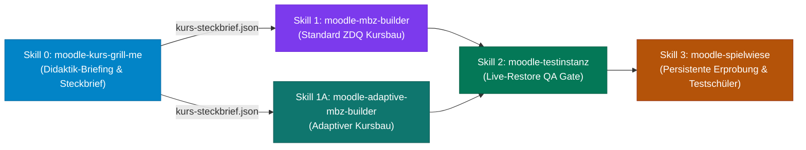

# moodle-kurs-grill-me

**Didaktisches Alignment-Interview ("Grill-Me") für berufliche und technische Moodle-Kurse.**

Dieser Skill fungiert als **Schritt 0 (Didaktik-Gate)** der Moodle-Kurs-Pipeline. Er führt vor der technischen Erstellung eines Moodle-Kurses ein fundiertes, iteratives Befragungskonzept in 6 thematischen Clustern durch und erzeugt einen normierten, schema-geprüften **Kurs-Steckbrief** (`kurs-steckbrief.json`).

---

## Die 6 Themen-Cluster

| # | Cluster | Inhalt & Didaktische Substanz |
|---|---|---|
| 1 | **Curriculares Profil & Lerngruppe** | Schulform (Duale BBS, BFS, FOS, BGY, AV, Technikerschule, Sek 1/2), Fachbereich, Lernfeld, Vorwissen, DaZ/Heterogenität. Abgleich mit der Lehrplan-Datenbank `references/curricula/`. |
| 2 | **Authentische Handlungssituation** | Reales betriebliches Szenario (Kunde/Auftraggeber, Arbeitsort, konkrete Störung/Montageaufgabe), Handlungsprodukt (Was geben die Lernenden ab?). |
| 3 | **Fachinhalte, Berechnungen & Normen** | Fachbegriffe (Glossar), vollständige 5-Punkte-Musterrechnungen (Geg/Ges/Einheiten/Zwischenschritt), Normen (DIN EN 60617, VDE, DGUV V3), Sicherheitsregeln. |
| 4 | **Aufgaben-Architektur & Kaskade** | 3-stufige Aufgabenkaskade: 1. Formative Erkundungsaufgabe (Grundlagen), 2. Ausfüllbares Protokoll (`type: "formular"` mit Autosave) in Vertiefung, 3. Summative Praxisaufgabe (`type: "assign"` mit 6 Handlungsphasen & Bewertungsrubrik) in Anwendung. |
| 5 | **Interaktive Medien, Simulationen & Hotspots** | Interaktive Hotspot-Modelle (`type: "hotspot"` via `hotspot_engine.py`), dynamische Schieberegler-Simulationen (`sim_engine.py`), normgerechte Vektor-Schaltpläne (`circuit_builder.py`). |
| 6 | **Kachelstruktur, Profil & Format** | Didaktisches Profil (`zdq`, `theorie-praxis-tandem`, etc.), Kachelanzahl (4–6 Kacheln), Kachelformat (`tiles` mit Kachel-Fotos vs. `topics`), Tonalität (Du/Sie). |

---

## Methoden- und Format-Empfehlung (Pflicht)

Auf Basis von Schulform, Zielgruppe und Thema unterbreitet der Grillmaster im Gespräch zwei strukturierte Auswahlentscheidungen mit fundierter Empfehlung `(Empfohlen)`:
- **E-Learning-Format:** *Blended Learning (Theorie-Praxis-Tandem)* vs. *Flipped Classroom* vs. *Szenariobasiertes Lernen (PBL)* vs. *Microlearning* (siehe `references/methoden-und-elearning-formate.md`).
- **Didaktische Methoden:** Bewertung und Auswahl aus über 35 Fachmethoden via `scripts/method_recommender.py`.

---

## Pipeline-Integration

Sobald der Steckbrief freigegeben ist, wird der Kurs nahtlos an den jeweiligen Builder übergeben und kann in der **Moodle-Spielwiese** (`python spielwiese.py import <kurs.mbz> --schueler`) direkt erprobt werden.

## 📥 Installation

Dieser Skill ist Teil des Monorepos [`Moodle-Pipeline-OG`](https://github.com/Menkoban/Moodle-Pipeline-OG) und liegt dort unter `.claude/skills/moodle-kurs-grill-me/`. Installation und Aktualisierung für alle Skills gemeinsam: siehe [README im Hauptverzeichnis](../../../README.md#installation).

Für den Curriculum-Abruf (`scripts/fetch_curriculum.py`) bindet der Skill den Geschwisterordner `../shared` ein; der liegt im Monorepo unter `.claude/skills/shared/`.
