# Moodle-MBZ-Ökosystem: Master-Pipeline-Architektur

Dieses Dokument ist die verbindliche Referenz für den gesamten Kurs-Erstellungsprozess im Moodle-Ökosystem – vom ersten didaktischen Briefing bis zur persistenten Erprobung in der Moodle-Spielwiese.

---

## 🗺️ Gesamtübersicht des 4-Phasen-Modells

```mermaid
graph TD
    subgraph PHASE_0 ["PHASE 0 · Didaktisches Intake & Alignment (moodle-kurs-grill-me)"]
        A1["1. Strukturiertes Grill-Me Interview<br/>(6 Cluster: Zielberuf, Roter Faden, Fachinhalte,<br/>Aufgaben-Kaskade, Medien, Kacheltiefe)"] --> A2["2. Methoden-Recommender<br/>(8–10 Auswahloptionen mit Multi-Select)"]
        A2 --> A3["Gate 0: Freigabe kurs-steckbrief.json"]
    end

    subgraph PHASE_1 ["PHASE 1 · Konzeption & Medien-Erstellung (moodle-mbz-builder)"]
        A3 --> B1["1. course.json Struktur & Narrative Arc"]
        B1 --> B2["2. DIN-Vektorgrafiken & Safe-Zone Cover<br/>(validate_svg.py --strict -> 0 Fehler)"]
        B2 --> B3["Gate 1: Grafiken & Struktur valide"]
        B3 --> B4["3. Interaktive Medien-Trias generieren<br/>• Hotspots (hotspot_engine.py)<br/>• Simulationen (sim_engine.py)<br/>• Ausfüllbare Formulare (form_engine.py)"]
        B4 --> B5["Gate 2: Interaktive Medien & Vorschau (*_vorschau.html)"]
    end

    subgraph PHASE_2 ["PHASE 2 · Materialisierung & Paketierung (make_materials & build_mbz)"]
        B5 --> C1["1. make_materials.py<br/>(PDF-Infoblätter, PPTX-Folien, Kurs-Materialdossier.pdf)"]
        C1 --> C2["Gate 3: Drucksätze & Dossier vorhanden"]
        C2 --> C3["2. build_mbz.py<br/>(moodle2 XML-Struktur, Tiles-Icons, Medien-Embeds)"]
        C3 --> C4["Gate 4: validate_mbz.py grün (Exit 0)"]
        C4 --> C5["3. Video/Audio-Recap Integration<br/>(set_recap_video.py / Audio-Player)"]
        C5 --> C6["Gate 5: Vollständige .mbz Datei gebaut"]
    end

    subgraph PHASE_3 ["PHASE 3 · Qualitätssicherung & Erprobung (testinstanz & spielwiese)"]
        C6 --> D1["1. 9-Stufen-Gatekeeper check_delivery.py<br/>(XML, Pfade, SHA1-Pool, Materialien, Recap)"]
        D1 --> D2["2. Automatischer Live-Restore (moodle-testinstanz)"]
        D2 --> D3["Gate 6: GATE GRÜN vor Auslieferung"]
        D3 --> D4["3. Import in persistente Moodle-Spielwiese<br/>(spielwiese.py import <kurs>.mbz --schueler)"]
        D4 --> D5["Gate 7 / Final: Interaktiver Schüler-Test (schueler01..05)"]
    end
```

---

## 📋 Die 8 Gates im Detail: Wann kommt welcher Schritt und was beinhaltet er?

| Gate | Phase & Zuständigkeit | Input | Durchgeführte Aktion / Skript | Ergebnis / Output-Artefakt | Qualitätskriterium |
|:---:|---|---|---|---|---|
| **Gate 0** | **Intake & Briefing** `moodle-kurs-grill-me` | Nutzer-Idee / Thema | 6-Cluster-Interview, Abfrage von Zielberuf, didaktischem Konzept, Aufgaben-Kaskade, Kachel-Tiefencheck | `kurs-steckbrief.json` | Vollständige Klärung aller 6 Cluster; Freigabe durch den Nutzer. |
| **Gate 1** | **Struktur & SVGs** `moodle-mbz-builder` | `kurs-steckbrief.json` | Erstellung von `course.json`, Zeichnen aller Fach-SVGs nach DIN EN 60617 und der 8 textfreien Kachel-Cover | `course.json`, `assets/*.svg` | `validate_svg.py --strict` liefert **0 Fehler, 0 Warnungen**. |
| **Gate 2** | **Vorschau & Editor** `moodle-mbz-builder` | `course.json` | Generierung der autarken HTML-Lese-Vorschau und des interaktiven Editor-Widgets | `*_vorschau.html`, `editor.html` | Browser-Vorschau öffnet fehlerfrei und zeigt alle Kacheln & Aktivitäten. |
| **Gate 3** | **Interaktive Medien-Trias** `moodle-mbz-builder` | SVG-Assets & `course.json` | Bauen der Hotspot-Labore (`hotspot_engine.py`), dynamischen Simulationen (`build_simulation.py`) und Formulare mit Autosave | `sims/*.html`, `course.sim.json` | Alle Simulationen animieren flüssig; Formulare sichern Eingaben im LocalStorage. |
| **Gate 4** | **Materialien-Pipeline** `moodle-mbz-builder` | `course.sim.json` | `make_materials.py` erzeugt druckbare Handouts, PPTX-Folien und das Dossier | `materials/*.pdf`, `materials/*.pptx`, `Kurs-Materialdossier.pdf` | Druckbare PDFs für alle Infoblätter mit `material: true` vorhanden. |
| **Gate 5** | **MBZ-Paketierung** `moodle-mbz-builder` | `course.sim.materialized.json` | `build_mbz.py` generiert das moodle2 GZIP-Tar-Archiv mit allen XML-Trees und Medien-Verlinkungen | `<kurs-slug>.mbz` | `validate_mbz.py` bestätigt alle XML-Referenzen (Exit 0). |
| **Gate 6** | **Schluss-Gate & Live-Restore** `moodle-testinstanz` | `<kurs-slug>.mbz` & Kursordner | `check_delivery.py` führt 9-Punkte-Prüfung aus und restauriert die MBZ im lokalen Test-Moodle | QA-Prüfbericht, Moodle-Restore-Log | **GATE GRÜN:** Moodle akzeptiert die Sicherung ohne PHP- oder SQL-Fehler. |
| **Gate 7** | **Persistente Spielwiese** `moodle-spielwiese` | `<kurs-slug>.mbz` | Dauerhafter Import via `spielwiese.py import <kurs>.mbz --schueler` | Live-Kurs-URL (z.B. Port 8090 / id=15) | Kurs kann mit den Testkonten `schueler01`–`schueler05` durchgeklickt werden. |

---

## 🔄 Bidirektionaler Handoff & Fehlervermeidung

1. **Fehlender Steckbrief beim Builder-Aufruf:**
   * Versucht der Nutzer oder Agent direkt einen Kurs zu bauen, greift **Gate 0** und leitet sofort zu `moodle-kurs-grill-me` weiter.
2. **Qualitäts-Sperre (No-Bypass):**
   * Kein Kurs wird ausgeliefert, ohne dass **Gate 6 (`check_delivery.py`)** erfolgreich grün durchlaufen wurde.
3. **Continuous Narrative Guarantee:**
   * In Phase 0 und 1 wird sichergestellt, dass jede Kachel als Etappe desselben betrieblichen Falls (Vollständige Handlung) fungiert.
