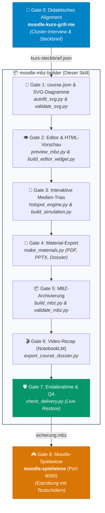

# moodle-mbz-builder 🎓📦

[](https://moodle.org/)
[](https://www.python.org/)
[](https://moodle.org/plugins/format_tiles)
[](LICENSE)

**Automatisierter didaktischer Kurs-Generator für Moodle.**  
Aus einer einfachen JSON-Kursdefinition (`course.json`) erzeugt `moodle-mbz-builder` eine vollständig strukturierte, importfertige **Moodle-Kurssicherung (`.mbz`)** für Moodle 4.1+ und 4.5 LTS — inklusive selbstgezeichneter Fachdiagramme, interaktiver Medien (Hotspots, Canvas-Simulationen, Digitalprotokolle), druckbarer Begleitmaterialien (PDF/PPTX/DOCX), einer eigenständigen HTML-Vorschau und KI-gestützter Video-Recaps via NotebookLM.

---

## 🌟 Highlights & Kern-Features

- 🎯 **Duales Goldstandard-System:**
  - ⚙️ **Gewerblich-Technischer Goldstandard:** `assets/fewshot_bohrmaschine.json` (Fertigungstechnik, ZDQ-5-Ebenen-Progression, Arbeitssicherheit, Arbeitsplan-WPS & 4-Stufen-Rubriken).
  - 📐 **Mathematik-, Stochastik- & MINT-Goldstandard:** `assets/fewshot_mathematik_statistik.json` (Beschreibende Statistik, DIN 55303, standardisierte Lernziele mit Lehrerduplikat, reale Aufgabenblätter mit Moodle-Abgabeaktivitäten (`assign`), Formel-Anatomie-Hotspots & reaktive Schieberegler-Canvas-Simulationen).
- 🧩 **Interaktive Medien-Trias:**
  - 🔍 **Formel- & Bauteil-Hotspots (`hotspot_engine.py`):** Zoom- und klickbare Pins im oberen Dockingbereich ohne Verdeckung von Formelzeichen und Texten.
  - 🎛️ **Reaktive Schieberegler-Simulationen (`sim_engine.py`):** 60-fps Canvas-Berechnungen mit Live-DOM-Aktualisierung und interaktiven Prüf-Challenges.
  - 📝 **Digitale Protokolle & Formulare (`formular`):** Strukturierte 6-Schritte-Berechnungstabellen mit Indizes, Formelvalidierung und Autosave.
- 📐 **Strikte mathematische Typografie & Vektorgeometrie:**
  - Vektorielle Summenzeichen (Σ) mit horizontalen Schenkeln und rechts geöffnetem Vertex (`validate_math_symbols.py`).
  - Zentrierte Makrons (x̄) exakt über Variablen, saubere Indizes (x_i, n_i, s²) und standardisierte MathJax-Bruchstriche.
- 🛡️ **Automatisierte Qualitäts-Gates (Gate 0 bis 8):**
  - Strikte Validierungskette: `validate_svg.py`, `validate_math_formulas.py`, `validate_math_symbols.py`, `validate_interactive_media.py`, `validate_mbz.py` und E2E-Live-Restore via `check_delivery.py`.
- 📄 **Druckbare Begleitmaterialien:** Automatische Generierung von Einzel-PDFs, editierbaren PPTX-Präsentationsfolien und dem zusammenhängenden `Kurs-Materialdossier.pdf`.
- 🎬 **NotebookLM Video-Recap:** Integrierter Workflow zur Erstellung und Einbindung didaktischer Video-Zusammenfassungen.

---

## 🏗️ Architektur der Moodle-Pipeline



---

## 📦 Was am Ende herauskommt

| Ausgabedatei / Ordner | Beschreibung |
|---|---|
| `sicherung-moodle2-<kurs>.mbz` | Das finale Moodle-Backup — direkt importierbar über *Kursverwaltung → Wiederherstellen*. |
| `<kurs>_vorschau.html` | Vollständige, interaktive Lese-Vorschau aller Kacheln, Aktivitäten, Quizzes und Lösungen im Browser (ohne Moodle). |
| `editor.html` | Interaktives Kurs-Dashboard und Kachel-Editor. |
| `materials/` | Druckfertige **PDFs**, editierbare **PPTX-Folien** und das `Kurs-Materialdossier.pdf`. |
| `sims/` | Selbsttragende, interaktive HTML5-Simulationen und Hotspot-Widgets. |
| `assets/` | Textfreie, DIN-konforme Vektordiagramme und Kachel-Cover in der sicheren Bildzone. |

---

## 💻 Installation & Setup

Dieser Skill kann sowohl mit **Antigravity / Gemini CLI** als auch mit **Claude Code** oder als **Standalone Python CLI** betrieben werden.

### Voraussetzungen
- **Python 3.10+** (inkl. `pip`)
- **Git**
- *(Optional für E2E-Browsertests):* `playwright` (`pip install playwright && playwright install chromium`)

### 1. Repository klonen

Dieser Skill ist Teil des Monorepos [`Moodle-Pipeline-OG-`](https://github.com/Menkoban/Moodle-Pipeline-OG-) und liegt dort unter `.claude/skills/moodle-mbz-builder/`. Installation und Aktualisierung für alle Skills gemeinsam: siehe [README im Hauptverzeichnis](../../../README.md#installation).

### 2. Python-Abhängigkeiten installieren

```bash
cd .claude/skills/moodle-mbz-builder
pip install -r requirements.txt
playwright install chromium
```

---

## 🚀 Schnellstart & Workflow

### 1. Kursdefinition erstellen (`course.json`)
Erstelle eine Kursdefinition basierend auf einem der Goldstandards:
```bash
# Gewerblich-Technischer Kurs:
cp assets/fewshot_bohrmaschine.json course.json

# Mathematik- & MINT-Kurs:
cp assets/fewshot_mathematik_statistik.json course.json
```

### 2. Build-Pipeline ausführen

Die Erstellung erfolgt in 4 einfachen Schritten:

```bash
# 1. Simulationen & Hotspots generieren
python scripts/build_simulation.py course.json -o course.sim.json

# 2. Begleitmaterialien (PDF, PPTX, Dossier) erzeugen
python scripts/make_materials.py course.sim.json -o course.sim.materialized.json

# 3. Moodle-Kurssicherung (.mbz) packen
python scripts/build_mbz.py course.sim.materialized.json -o mein-moodle-kurs.mbz

# 4. Lese-Vorschau erzeugen
python scripts/preview_mbz.py course.json -o mein-moodle-kurs_vorschau.html
```

### 3. Qualitätsprüfung & QA-Gate

Führe vor der Auslieferung die Endabnahme durch:
```bash
python scripts/check_delivery.py . --allow-video-placeholder
```
*Prüft automatisch XML-Wohlgeformtheit, relative Pfade, mathematische Typografie, Vektorsymbole, Medien-Vollständigkeit und führt einen Live-Restore-Test im lokalen Moodle-Lab durch.*

---

## 🛠️ CLI-Werkzeuge & Skripte im Überblick

| Skript | Aufgabe |
|---|---|
| `scripts/build_mbz.py` | Erzeugt das fertige Moodle-Gzip-Tar-Archiv (`.mbz`) aus der JSON-Spezifikation. |
| `scripts/build_simulation.py` | Kompiliert interaktive Schieberegler-Simulationen und Hotspots in eigenständige HTML-Ressourcen. |
| `scripts/hotspot_engine.py` | Generiert interaktive Formel- und Bauteil-Anatomien mit responsivem Pin-Docking. |
| `scripts/make_materials.py` | Wandelt Infoblätter (`material: true`) in PDFs, PPTX-Folien und Lehrer-Dossiers um. |
| `scripts/preview_mbz.py` | Rendert eine eigenständige Komplett-Vorschau (`_vorschau.html`) ohne Moodle-Instanz. |
| `scripts/validate_mbz.py` | Tiefgehende statische Validierung des `.mbz`-Archivs (XML, SHA1-Pool, Module, Rubriken). |
| `scripts/validate_math_symbols.py` | Geometrische Vektorprüfung für mathematische Zeichen (Σ, x̄, √). |
| `scripts/validate_math_formulas.py` | Typografie-Prüfung für HTML-Subskripte, MathJax-Brüche und Variablensymbole. |
| `scripts/validate_svg.py` | Prüft SVGs auf viewBox, Farbkontraste, Schriftgrößen und Safe-Zones. |
| `scripts/check_delivery.py` | Zentrales Gate-Skript: Führt alle Validatoren und den Moodle-Live-Restore aus. |

---

## 🤝 Zusammenarbeit in der Pipeline

`moodle-mbz-builder` arbeitet Hand in Hand mit den weiteren Skills im selben Repo:
- 📋 [**moodle-kurs-grill-me**](../moodle-kurs-grill-me/): Didaktisches Alignment-Interview vor dem Kursbau.
- 🧪 [**moodle-testinstanz**](../moodle-testinstanz/): Steriles Moodle-4.5-Lab für automatisierte Live-Restore-Checks.
- 🎮 [**moodle-spielwiese**](../moodle-spielwiese/): Persistente Moodle-4.5-Spielwiese (Port 8090) zur Erprobung mit Testschülern.

---

## 📄 Lizenz

Dieses Projekt ist unter der **MIT-Lizenz** lizenziert.
