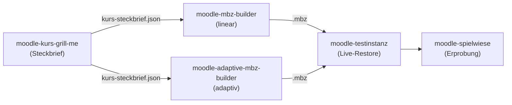

# Moodle-Pipeline (OG)

Die ursprüngliche Moodle-Kurspipeline in **einem** Repository: vom didaktischen
Interview über den Kursbau bis zur geprüften, einspielbaren Kurssicherung
(`.mbz`) und ihrer Erprobung mit Testschülern.

Bis Oktober 2026 lagen die Bausteine in fünf getrennten Repos. Sie sind hierher
umgezogen, **mit ihrer vollständigen Git-Historie** (siehe [Herkunft](#herkunft)).

## Die Skills

Alle Skills liegen unter `.claude/skills/`. Startet man Claude Code in diesem
Repo, werden sie automatisch als Projekt-Skills geladen.

| Schritt | Skill | Aufgabe |
|---|---|---|
| Gate 0 | [`moodle-kurs-grill-me`](.claude/skills/moodle-kurs-grill-me/) | Didaktisches Interview in Themen-Clustern → `kurs-steckbrief.json` |
| Gates 1–5 | [`moodle-mbz-builder`](.claude/skills/moodle-mbz-builder/) | Linearer Kursbau: `course.json`, Diagramme, Simulationen, Materialien, `.mbz` |
| Gates 1–5 | [`moodle-adaptive-mbz-builder`](.claude/skills/moodle-adaptive-mbz-builder/) | Adaptiver Kursbau mit Niveaupfaden (Fork des linearen Builders) |
| Gate 6 | [`moodle-testinstanz`](.claude/skills/moodle-testinstanz/) | Live-Restore der `.mbz` in einem lokalen Test-Moodle |
| Gate 7 | [`moodle-spielwiese`](.claude/skills/moodle-spielwiese/) | Persistente Moodle-Spielwiese zum Durchklicken als Testschüler |
| — | [`shared`](.claude/skills/shared/) | Hilfsmodule für den Lehrplan-Abruf von `moodle-kurs-grill-me` (kein eigener Skill) |



Die verbindliche Beschreibung aller Gates steht in
[`moodle-mbz-builder/references/pipeline-architektur.md`](.claude/skills/moodle-mbz-builder/references/pipeline-architektur.md).

## Installation

Voraussetzungen: **Git** und **Python 3.10+**. Für Testinstanz und Spielwiese
zusätzlich **Windows** (sie laden portable PHP-, MariaDB- und Apache-Binaries).

```bash
git clone https://github.com/Menkoban/Moodle-Pipeline-OG-.git
cd Moodle-Pipeline-OG-
python -m pip install -r requirements.txt
```

Danach Claude Code im Repo-Ordner starten — die Skills sind sofort verfügbar.

**Skills überall nutzen (global):** den Inhalt von `.claude/skills/` nach
`~/.claude/skills/` kopieren (bzw. für Antigravity/Gemini CLI nach
`~/.gemini/config/skills/`). Wichtig: **alle Ordner gemeinsam** kopieren —
die Skills finden einander als Geschwisterordner (der Builder die Testinstanz,
Grill-Me den Ordner `shared`).

**Aktualisieren:** `git pull` im Repo (bei globaler Nutzung danach erneut kopieren).

> Wer die Skills früher einzeln nach `~/.claude/skills/moodle-*` geklont hat:
> Diese alten Kopien bitte entfernen. Die Skripte bevorzugen zwar den
> Geschwisterordner im Repo, doppelte Skills mit gleichem Namen verwirren aber
> Claude bei der Auswahl.

## Tests

Jeder Skill hat seine Tests im eigenen `tests/`-Ordner:

```bash
cd .claude/skills/moodle-mbz-builder && python -m pytest -q tests
```

Stand nach dem Umzug (31.10.2026, Linux-Container):

| Skill | Ergebnis |
|---|---|
| `moodle-mbz-builder` | 141 bestanden |
| `moodle-adaptive-mbz-builder` | 161 bestanden |
| `moodle-kurs-grill-me` | 9 bestanden, 1 rot (`test_cached_elektroniker_lookup` braucht einen lokal abgelegten Lehrplan im Cache — war vor dem Umzug genauso) |
| `moodle-testinstanz` | 2 übersprungen (brauchen das Windows-Lab) |
| `moodle-spielwiese` | keine automatischen Tests |

## Herkunft

| Ordner | Früheres Repo | Branch | Letzter Commit |
|---|---|---|---|
| `.claude/skills/moodle-kurs-grill-me` | `Menkoban/moodle-kurs-grill-me` | `main` | `daff8c8` |
| `.claude/skills/moodle-mbz-builder` | `Menkoban/moodle-mbz-builder` | `master` | `4fdffb3` |
| `.claude/skills/moodle-adaptive-mbz-builder` | `Menkoban/moodle-adaptive-mbz-builder` | `master` | `4934a8f` |
| `.claude/skills/moodle-testinstanz` | `Menkoban/moodle-testinstanz` | `master` | `8246020` |
| `.claude/skills/moodle-spielwiese` | `Menkoban/moodle-spielwiese` | `master` | `4dfeedc` |
| `.claude/skills/shared` (3 Dateien, ohne Historie) | `Menkoban/shared` | `main` | `bd08eb0` |

Die Historie wurde mit `git filter-repo --to-subdirectory-filter` in die
Unterordner verschoben; die Commit-Hashes sind deshalb neu, Inhalt, Autoren und
Daten unverändert. Die Geschichte einer Datei zeigt `git log --follow -- <pfad>`.

`Menkoban/shared` gehört zur Unterrichtsplanungs-Pipeline und bleibt bestehen;
hier liegt nur eine Kopie der drei Module, die Grill-Me braucht.

## Lizenz

Die Skills tragen ihre bisherigen Lizenzangaben in ihren Ordnern
(z. B. MIT für `moodle-testinstanz` und `moodle-mbz-builder`).
