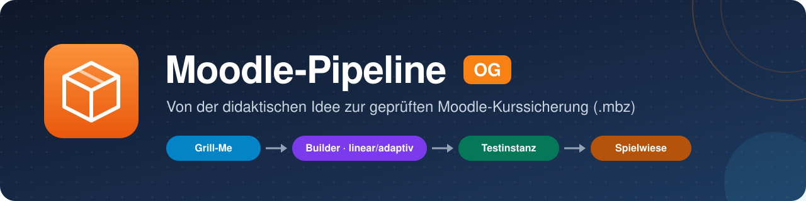
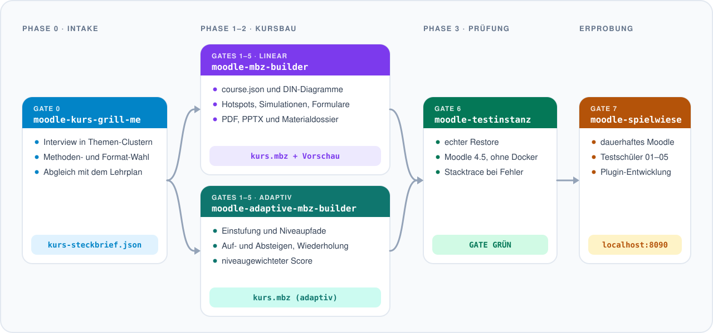
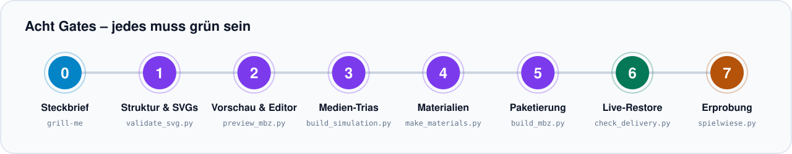
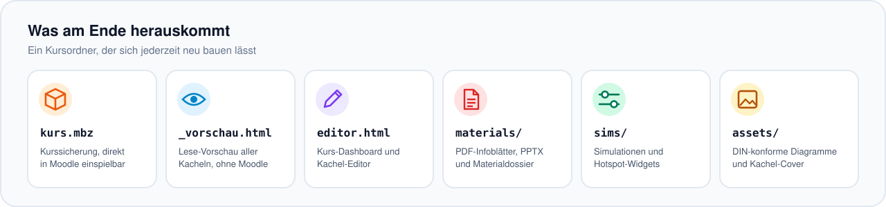

<p align="center">
  
</p>

<p align="center">
  
  
  
  
  
  
</p>

<p align="center">
  <b>Aus einer didaktischen Idee wird ein fertiger, geprüfter Moodle-Kurs.</b><br>
  Ein Interview klärt, was der Kurs leisten soll – die Pipeline baut Kacheln, Diagramme,<br>
  Simulationen und Materialien, packt alles in eine <code>.mbz</code> und prüft sie in einem echten Moodle.
</p>

<p align="center">
  <a href="#-schnellstart">Schnellstart</a> ·
  <a href="#-so-funktioniert-es">So funktioniert es</a> ·
  <a href="#-die-skills">Die Skills</a> ·
  <a href="#-installation">Installation</a> ·
  <a href="#-nutzung">Nutzung</a> ·
  <a href="#-tests">Tests</a> ·
  <a href="#-herkunft">Herkunft</a>
</p>

---

## ✨ Auf einen Blick

- 🎯 **Didaktik zuerst:** Kein Kurs ohne Steckbrief – ein strukturiertes Interview (Gate 0) klärt Zielgruppe, Handlungssituation, Fachinhalte, Aufgaben und Medien, bevor gebaut wird.
- 🧱 **Linear oder adaptiv:** Der Standard-Builder baut Kachelkurse nach dem ZDQ-Modell, der adaptive Builder verzweigte Kurse mit Einstufung und Niveaupfaden.
- 🧩 **Interaktive Medien:** Hotspot-Labore, Schieberegler-Simulationen und ausfüllbare Formulare mit Autosave – als eigenständige HTML-Ressourcen im Kurs.
- 📐 **Saubere Fachgrafik:** Textfreie DIN-Diagramme und Kachel-Cover, automatisch auf Überlauf, Kontrast und Safe-Zone geprüft.
- 📄 **Material zum Ausdrucken:** PDF-Infoblätter, editierbare PPTX-Folien und ein zusammenhängendes Materialdossier.
- 🛡️ **Echte Prüfung statt Hoffnung:** Statische Validatoren für XML, Pfade und Typografie – und ein Live-Restore in einem lokalen Moodle, der genau die Fehler findet, die erst beim Einspielen auftreten.

## 🚀 Schnellstart

```bash
git clone https://github.com/Menkoban/Moodle-Pipeline-OG-.git
cd Moodle-Pipeline-OG-
python -m pip install -r requirements.txt

# Beispielkurs bauen und prüfen – ganz ohne Moodle
python .claude/skills/moodle-mbz-builder/scripts/build_mbz.py \
       .claude/skills/moodle-mbz-builder/assets/example_course.json -o beispiel.mbz
python .claude/skills/moodle-mbz-builder/scripts/validate_mbz.py beispiel.mbz
```

Die `beispiel.mbz` lässt sich in jedem Moodle über *Kursverwaltung → Wiederherstellen* einspielen.

Für einen echten Kurs startest du **Claude Code im Repo-Ordner** und sagst zum Beispiel:

> *„Ich möchte einen Moodle-Kurs zum Thema Motorschutz für Elektroniker im 2. Ausbildungsjahr bauen.“*

Claude beginnt dann mit dem Grill-Me-Interview und führt dich durch alle Gates.

## 🗺️ So funktioniert es

<p align="center">
  
</p>

Jede Stufe übergibt ein festes Artefakt an die nächste: den **Kurs-Steckbrief** (`kurs-steckbrief.json`), dann die **Kurssicherung** (`.mbz`). Der Builder fragt nie selbst nach Didaktik – fehlt der Steckbrief, geht es zurück zu Gate 0.

<p align="center">
  
</p>

Ausgeliefert wird nur, was **Gate 6** grün durchlaufen hat. Die verbindliche Beschreibung aller Gates mit Ein- und Ausgaben steht in [`pipeline-architektur.md`](.claude/skills/moodle-mbz-builder/references/pipeline-architektur.md).

## 🧰 Die Skills

Alle Skills liegen unter [`.claude/skills/`](.claude/skills/) und werden von Claude Code automatisch geladen, sobald es im Repo gestartet wird.

| | Skill | Gate | Aufgabe |
|:-:|---|:-:|---|
| 📋 | [**moodle-kurs-grill-me**](.claude/skills/moodle-kurs-grill-me/) | 0 | Didaktisches Interview in sechs Themen-Clustern mit Methoden- und Format-Empfehlung → `kurs-steckbrief.json` |
| 📦 | [**moodle-mbz-builder**](.claude/skills/moodle-mbz-builder/) | 1–5 | Linearer Kursbau: Struktur, Diagramme, interaktive Medien, Materialien, `.mbz`, Vorschau und Editor |
| 🌿 | [**moodle-adaptive-mbz-builder**](.claude/skills/moodle-adaptive-mbz-builder/) | 1–5 | Adaptiver Kursbau: Einstufung, durchlässige Niveaupfade, Wiederholschleife, niveaugewichteter Score |
| 🧪 | [**moodle-testinstanz**](.claude/skills/moodle-testinstanz/) | 6 | Live-Restore in einem portablen Moodle 4.5 – liefert bei Fehlern den echten Stacktrace |
| 🎮 | [**moodle-spielwiese**](.claude/skills/moodle-spielwiese/) | 7 | Dauerhaftes Moodle auf Port 8090 zum Durchklicken mit Testschülern und für Plugin-Entwicklung |
| 🔧 | [shared](.claude/skills/shared/) | – | Hilfsmodule für den Lehrplan-Abruf von Grill-Me (kein eigener Skill) |

<p align="center">
  
</p>

## 💻 Installation

**Voraussetzungen:** Git und Python 3.11 oder neuer. Für Testinstanz und Spielwiese zusätzlich **Windows 10/11** – beide arbeiten mit portablen PHP-, MariaDB- und Apache-Programmen, ganz ohne Docker.

```bash
git clone https://github.com/Menkoban/Moodle-Pipeline-OG-.git
cd Moodle-Pipeline-OG-
python -m pip install -r requirements.txt
```

Damit ist alles da, was zum **Bauen** von Kursen nötig ist (rund 4 MB). Ein Moodle wird dabei **nicht** heruntergeladen. Wer Kurse live prüfen oder erproben will, richtet die Instanzen einmalig selbst ein:

```bash
python .claude/skills/moodle-testinstanz/scripts/setup_lab.py    # Test-Moodle für Gate 6 (~450 MB, 10–20 min)
python .claude/skills/moodle-spielwiese/scripts/spielwiese.py setup  # Spielwiese unter C:\moodle-playground
```

Ohne Test-Moodle läuft die Endabnahme trotzdem – der Live-Restore wird dann mit einem Hinweis übersprungen.

<details>
<summary><b>Skills global nutzen (in jedem Projekt)</b></summary>

<br>

Den Inhalt von `.claude/skills/` nach `~/.claude/skills/` kopieren (für Antigravity / Gemini CLI nach `~/.gemini/config/skills/`). Dabei **alle Ordner gemeinsam** kopieren – die Skills finden einander als Geschwisterordner: der Builder die Testinstanz, Grill-Me den Ordner `shared`.

</details>

<details>
<summary><b>Umstieg von den alten Einzel-Repos</b></summary>

<br>

Wer die Skills früher einzeln nach `~/.claude/skills/moodle-*` geklont hat, sollte diese Kopien entfernen. Die Skripte bevorzugen zwar die Geschwisterordner im Repo, doppelte Skills mit gleichem Namen verwirren Claude aber bei der Auswahl.

</details>

**Aktualisieren:** `git pull` im Repo.

## 🛠️ Nutzung

Am bequemsten über Claude Code – die Skills sagen Claude, welches Skript wann läuft. Alle Schritte gehen aber auch von Hand:

```bash
cd .claude/skills/moodle-mbz-builder

python scripts/build_simulation.py course.json -o course.sim.json                     # Gate 3: Simulationen & Hotspots
python scripts/make_materials.py course.sim.json -o course.sim.materialized.json      # Gate 4: PDF, PPTX, Dossier
python scripts/build_mbz.py course.sim.materialized.json -o mein-kurs.mbz             # Gate 5: Kurssicherung
python scripts/preview_mbz.py course.json -o mein-kurs_vorschau.html                  # Lese-Vorschau
python scripts/check_delivery.py <kursordner>                                         # Gate 6: Endabnahme + Live-Restore
```

Testinstanz und Spielwiese:

```bash
python .claude/skills/moodle-testinstanz/scripts/run_restore.py --health          # läuft das Test-Moodle?
python .claude/skills/moodle-testinstanz/scripts/run_restore.py mein-kurs.mbz     # Restore mit Stacktrace bei Fehler
python .claude/skills/moodle-spielwiese/scripts/spielwiese.py start
python .claude/skills/moodle-spielwiese/scripts/spielwiese.py import mein-kurs.mbz --schueler
```

Ausführliche Anleitungen stehen in der `SKILL.md` und im `README.md` jedes Skills.

## 📁 Aufbau des Repositorys

```
Moodle-Pipeline-OG-/
├── .claude/skills/
│   ├── moodle-kurs-grill-me/          Gate 0 · Interview und Steckbrief
│   ├── moodle-mbz-builder/            Gates 1–5 · linearer Kursbau
│   ├── moodle-adaptive-mbz-builder/   Gates 1–5 · adaptiver Kursbau
│   ├── moodle-testinstanz/            Gate 6 · Live-Restore
│   ├── moodle-spielwiese/             Gate 7 · Erprobung
│   └── shared/                        Hilfsmodule für den Lehrplan-Abruf
├── docs/bilder/                       Grafiken dieses README (SVG)
├── requirements.txt                   Python-Abhängigkeiten aller Skills
└── README.md
```

Jeder Skill-Ordner hat denselben Aufbau: `SKILL.md` (Anleitung für Claude), `scripts/`, `references/`, `assets/` und `tests/`.

## ✅ Tests

Jeder Skill bringt seine Tests im eigenen `tests/`-Ordner mit:

```bash
cd .claude/skills/moodle-mbz-builder && python -m pytest -q tests
```

| Skill | Ergebnis | Hinweis |
|---|---|---|
| `moodle-mbz-builder` | ✅ 141 bestanden | |
| `moodle-adaptive-mbz-builder` | ✅ 161 bestanden | |
| `moodle-kurs-grill-me` | ⚠️ 9 bestanden, 1 rot | `test_cached_elektroniker_lookup` braucht einen lokal zwischengespeicherten Lehrplan |
| `moodle-testinstanz` | ⏭️ 2 übersprungen | brauchen das Test-Moodle unter Windows |
| `moodle-spielwiese` | – | keine automatischen Tests |

Stand: 31.10.2026, nach dem Umzug in dieses Repo – identisch mit den Ergebnissen in den alten Einzel-Repos.

## 🧬 Herkunft

Bis Oktober 2026 lag jeder Skill in einem eigenen Repository. Alle sind mit ihrer **vollständigen Git-Historie** hierher umgezogen.

<details>
<summary><b>Woher welcher Ordner stammt</b></summary>

<br>

| Ordner | Früheres Repo | Branch | Letzter Commit |
|---|---|---|---|
| `moodle-kurs-grill-me` | `Menkoban/moodle-kurs-grill-me` | `main` | `daff8c8` |
| `moodle-mbz-builder` | `Menkoban/moodle-mbz-builder` | `master` | `4fdffb3` |
| `moodle-adaptive-mbz-builder` | `Menkoban/moodle-adaptive-mbz-builder` | `master` | `4934a8f` |
| `moodle-testinstanz` | `Menkoban/moodle-testinstanz` | `master` | `8246020` |
| `moodle-spielwiese` | `Menkoban/moodle-spielwiese` | `master` | `4dfeedc` |
| `shared` (3 Dateien, ohne Historie) | `Menkoban/shared` | `main` | `bd08eb0` |

Die Historie wurde mit `git filter-repo --to-subdirectory-filter` in die Unterordner verschoben. Die Commit-Hashes sind dadurch neu; Inhalte, Autoren und Daten sind unverändert. Die Geschichte einer Datei zeigt `git log --follow -- <pfad>`.

`Menkoban/shared` gehört zur Unterrichtsplanungs-Pipeline und bleibt bestehen – hier liegt nur eine Kopie der drei Module, die Grill-Me braucht.

</details>

## 📄 Lizenz

Die Skills behalten ihre bisherigen Lizenzangaben in ihren Ordnern (MIT laut Angabe in `moodle-testinstanz`, `moodle-mbz-builder` und `moodle-spielwiese`; eine LICENSE-Datei liegt bisher nur in `moodle-testinstanz`). Moodle, PHP, MariaDB und die Moodle-Plugins, die Testinstanz und Spielwiese beim Einrichten laden, stehen unter ihren eigenen Lizenzen.
